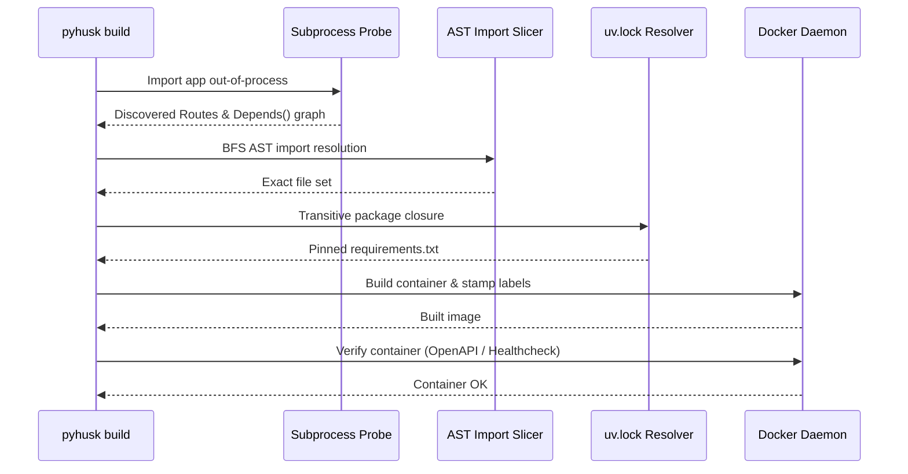

# Docker Slicing & Verification

The core build engine of `pyhusk` produces minimal, verified Docker images by extracting only the files and lockfile dependencies each service actually reaches.

---

## The Build Pipeline



---

## 1. Out-of-Process Route & Dependency Probing

Application code often performs configuration validation, database setup, or dependency injection via FastAPI's `Depends()`.

pyhusk executes an out-of-process probe inside your project's `.venv`:
- It imports the entrypoint without polluting pyhusk's own runtime.
- It walks `app.routes` and inspects Starlette `Route`, `Mount`, and `APIRoute` trees.
- It recursively resolves FastAPI `dependant` trees to find every callable invoked by route handlers.

---

## 2. Lockfile Dependency Pruning

Application code never imports its ASGI server (`uvicorn`); the server imports the app. Naive dependency extractors miss server packages or include whole-repo bloat.

pyhusk:
1. Maps third-party imports to distributions using `importlib.metadata.packages_distributions()`.
2. Computes the transitive dependency closure directly from `uv.lock`.
3. Auto-injects `uvicorn` only when building FastAPI workloads.
4. Generates a hermetically pinned `requirements.txt` (`package==1.2.3`).

---

## 3. Ephemeral Staleness via Registry Labels

How does pyhusk know whether an image needs rebuilding on a fresh CI runner without a local cache?

Every built image is stamped with two Docker labels:
- `org.pyhusk.slice`: SHA-256 hash of all sliced files, lockfile pins, Dockerfile, and base image digest.
- `org.pyhusk.commit`: Last git commit hash touching any file in the slice.

When running in CI:
```bash
pyhusk plan --json
```
pyhusk queries the container registry (`buildx imagetools inspect`). If the remote label matches the local slice hash, the build is skipped as **unchanged**, saving registry bandwidth and compute minutes.

---

## 4. Three-Tier Container Verification

A pruned image is useless if it crashes on boot due to a missing asset. Before calling a build successful, pyhusk spins up the container and runs automated verification:

| Tier | When Used | Verification Check |
|---|---|---|
| **`schema`** | Default for FastAPI apps | Boots container, queries `/openapi.json`, and verifies all discovered routes and HTTP methods are served. |
| **`healthcheck`** | When OpenAPI is disabled | Polls configured `healthcheck` path (e.g. `/healthz`) until HTTP 200 is returned. |
| **`boot`** | Workers & minimal apps | Verifies the container stays up and alive without crashing. |

If verification fails:
1. pyhusk prints container logs (`stdout` and `stderr`).
2. Immediately untags/removes the broken image (`docker rmi -f`).
3. Exits with non-zero code. This prevents broken images from being stamped as fresh.
