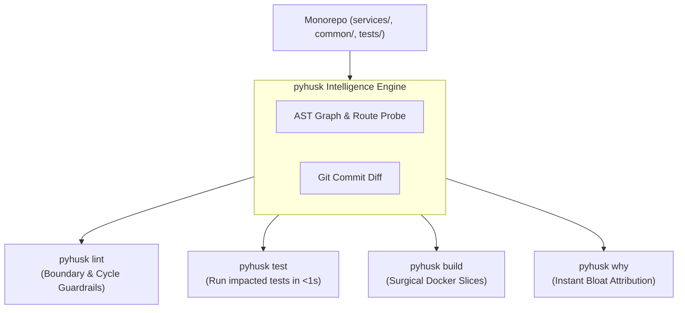

# pyhusk

FastAPI monorepos without the monorepo tax. Enforce clean architectural boundaries, run sub-second selective CI tests, and build surgical Docker images containing only the code your service actually imports.

---

  

    <h3>🛡️ Boundary Guardrails</h3>
    
Block cross-service coupling and banned heavy packages with <code>pyhusk lint</code>. Detect import cycles and dead code before it lands in production.

  

  

    <h3>⚡ Sub-Second Selective Testing</h3>
    
Stop rerunning 15-minute test suites. <code>pyhusk test --since origin/main</code> uses AST graph analysis to run only test files touched by your PR.

  

  

    <h3>📦 Surgical Docker Slicing</h3>
    
Trace runtime <code>Depends()</code> and import graphs. Cut multi-gigabyte monolithic containers into tiny, audited microservice images.

  

  

    <h3>🔍 Bloat Lineage Detective</h3>
    
Find out why <code>pandas</code> or <code>torch</code> leaked into your auth service. <code>pyhusk why &lt;svc&gt; &lt;pkg&gt;</code> prints the exact shortest import path.

  

  

    <h3>🤖 AI Agent Native</h3>
    
Native skills for Claude Code, Antigravity, and Cursor. AI assistants run linting, plan builds, and verify code without hallucinating dependencies.

  

  

    <h3>📊 Verified Performance ROI</h3>
    
Measure exact time and storage savings against whole-repo baselines with <code>pyhusk benchmark</code>. Ready-to-share Markdown tables.

  

---

## Why pyhusk?

Most Python teams organize their backend as a monorepo: one root `pyproject.toml`, one `uv.lock`, a shared `common/` package, and several microservices (`services/auth`, `services/billing`, `services/worker`).

Without strict tooling, this causes three massive problems:

1. **Slow CI Pipelines**: Every pull request rebuilds every service image and runs every test suite, wasting developer time and compute budget.
2. **Accidental Dependency Bloat**: A developer imports a utility from `common/`, which imports an internal database driver or ML library, silently ballooning every service container by 500+ MB.
3. **Hidden Runtime Breakages**: Incomplete Dockerfiles fail in production because a dynamically injected dependency was missed.

---

## Core Philosophy

- **Zero Monorepo Restructuring**: No need to rewrite your repository into complex Bazel or Pants workspaces. Keep your clean `uv` workflow.
- **Payload Integrity**: Code, commands, file paths, and dependencies are treated as sacred payloads. pyhusk inspects files statically and out-of-process.
- **Fail Early, Fail Loud**: If a container slice is missing a file or fails to boot its OpenAPI schema, pyhusk fails before tagging the image, preventing broken deploys.

Ready to dive in? Check out the **[Quickstart Guide](quickstart.md)**.
