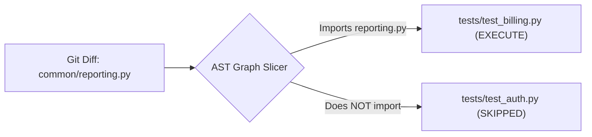

# Selective CI Testing

Why run 800 tests when your pull request only touched code used by 3 of them? `pyhusk test` uses your repository's import graph and git history to run only the tests affected by your changes.

---

## How It Works

1. **Change Detection**: Computes files modified between your branch and a base git reference (e.g. `origin/main` or `HEAD~1`), including uncommitted working-tree edits.
2. **Import Tree Slicing**: Builds the transitive local import tree for every test file (`tests/**/test_*.py`).
3. **Intersection Filtering**: If a test file's slice touches any modified file, that test file is scheduled for execution.



---

## Commands

### `pyhusk affected`
Inspect which services and test suites are impacted without executing tests:

```bash
pyhusk affected --since origin/main
```

```text
Changes since origin/main (2 file(s)):
Affected services (1): billing
Affected test files (2):
  tests/test_billing.py
  tests/test_reporting.py
```

Pass `--json` to output structured data directly into a GitHub Actions matrix!

### `pyhusk test`
Run `pytest` against only affected test files:

```bash
# Run tests affected since the main branch
pyhusk test --since origin/main

# Run tests affected by the last commit
pyhusk test --since HEAD~1

# Fall back to running all tests if no test files were affected
pyhusk test --since origin/main --all
```

---

## GitHub Actions CI Workflow

Drastically reduce your CI runtime and compute bills:

```yaml title=".github/workflows/test.yml"
name: Selective CI

on:
  pull_request:
    branches: [main]

jobs:
  test:
    runs-on: ubuntu-latest
    steps:
      - uses: actions/checkout@v4
        with:
          fetch-depth: 0 # Full history for git diffing
      - uses: astral-sh/setup-uv@v5
      - run: uv sync
      - name: Run Affected Tests
        run: uv run pyhusk test --since origin/main --all
```

> **Speed Impact:** Monorepos with 10–20 services typically see test step durations drop from **8–15 minutes down to 10–30 seconds**.
